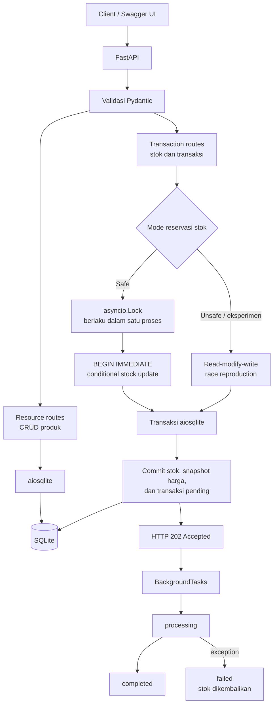

# Pelita POS API — Pemrograman Asynchronous

Backend berbasis FastAPI, Pydantic, `aiosqlite`, `BackgroundTasks`, dan
`asyncio.Lock`. Scope penilaian difokuskan pada CRUD produk, transaksi
asynchronous, eksperimen race condition, dan benchmark satu versus empat worker.

## Arsitektur



`asyncio.Lock` mengatur reservasi stok di dalam satu proses, sedangkan transaksi
SQLite dengan `BEGIN IMMEDIATE` dan conditional update menjaga konsistensi saat
API dijalankan dengan beberapa worker. `BackgroundTasks` melanjutkan siklus
transaksi setelah respons `202 Accepted` dikirim.

## Menjalankan aplikasi

```powershell
py -m venv .venv
.\.venv\Scripts\Activate.ps1
python -m pip install -r requirements.txt
python seed.py
uvicorn main:app --reload
```

- Swagger UI: <http://127.0.0.1:8000/docs>
- Health check: <http://127.0.0.1:8000/health>

## Endpoint API

| Method | Endpoint | Hasil utama |
| --- | --- | --- |
| `GET` | `/resource?skip=0&limit=10` | Daftar produk dan pagination |
| `GET` | `/resource/{id}` | Detail produk |
| `POST` | `/resource` | Membuat produk (`201`) |
| `PUT` | `/resource/{id}` | Mengganti produk (`200`) |
| `DELETE` | `/resource/{id}` | Hard delete atau `409` bila memiliki transaksi |
| `POST` | `/transactions` | Response `202 pending`, dilanjutkan background task |
| `GET` | `/transactions?status=completed` | Daftar dan filter status |
| `GET` | `/transactions/{id}` | Detail transaksi |

## Eksperimen race condition

Mode unsafe memperlebar celah read-modify-write agar overselling dapat diamati:

```powershell
$env:PELITA_UNSAFE_STOCK = "1"
uvicorn main:app --port 8000
```

Terminal lain:

```powershell
python test_race.py --mode unsafe
```

Mode aman:

```powershell
Remove-Item Env:PELITA_UNSAFE_STOCK -ErrorAction SilentlyContinue
uvicorn main:app --port 8000
python test_race.py --mode safe
```

Hasil yang diharapkan: unsafe menerima dua transaksi (`202/202`) terhadap stok
satu, sedangkan mode aman hanya menerima satu (`202/409`). Stok unsafe berakhir
0, bukan negatif, karena kedua request menulis nilai absolut yang sama; dua
penjualan untuk satu unit tetap membuktikan overselling.

## Benchmark Locust

Reset database sebelum setiap skenario:

```powershell
python benchmark_setup.py
```

Jalankan server satu atau empat worker:

```powershell
uvicorn main:app --workers 1 --port 8000
uvicorn main:app --workers 4 --port 8000
```

Read, 100 request:

```powershell
$env:REQUEST_LIMIT = "100"
locust -f locustfile.py ReadUser --headless -u 20 -r 20 `
  --host http://127.0.0.1:8000 --only-summary -t 5s
```

Write, 50 request:

```powershell
$env:REQUEST_LIMIT = "50"
locust -f locustfile.py TransactionUser --headless -u 10 -r 10 `
  --host http://127.0.0.1:8000 --only-summary -t 5s
```

CSV final berada di `docs/benchmark/`.

### Hasil benchmark

| Skenario | Worker | Request | Failure | Avg (ms) | P95 (ms) | Request/s | Total Waktu (s) |
| --- | ---: | ---: | ---: | ---: | ---: | ---: | ---: |
| `GET /resource` | 1 | 100 | 0 | 55.89 | 120 | 216.78 | 0.46 |
| `GET /resource` | 4 | 100 | 0 | 39.27 | 130 | 277.44 | 0.36 |
| `POST /transactions` | 1 | 50 | 0 | 144.31 | 190 | 50.09 | 1.00 |
| `POST /transactions` | 4 | 50 | 0 | 137.59 | 530 | 53.52 | 0.93 |

`Total Waktu` dihitung dari jumlah request dibagi request per detik. Seluruh
skenario selesai tanpa kegagalan request. Empat worker meningkatkan throughput,
tetapi P95 transaksi memburuk karena write SQLite tetap saling menunggu.

## Pengujian

```powershell
ruff check .
pytest -q
```

Catatan: `BackgroundTasks` berjalan di proses server yang sama. Jika proses mati
saat transaksi berstatus `processing`, pekerjaan in-memory tidak dapat dilanjutkan
otomatis; production memerlukan durable job queue atau mekanisme recovery.
